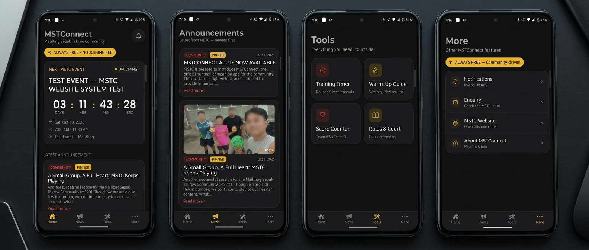

<div align="center">

<h1>MSTCONNECT</h1>

<h3>The companion app of the Malitbog Sepak Takraw Community (MSTC)</h3>

<h3><em>Play. Reconnect. Pass It On.</em></h3>

<a href="https://github.com/Roo0722/mstconnect-app-free/releases/latest/download/MSTConnect.apk">
  
</a>

<br>

[](https://github.com/Roo0722/mstconnect-app-free/releases/latest)
[](https://github.com/Roo0722/mstconnect-app-free/releases)
[](LICENSE)


<sub><b><a href="https://github.com/Roo0722/mstconnect-app-free/releases/latest/download/MSTConnect.apk">Download MSTConnect.apk</a></b> · Android · free · no account needed · [all releases](https://github.com/Roo0722/mstconnect-app-free/releases)</sub>

<br>



</div>

MSTConnect puts the community's announcements, events and training tools in your pocket. It is **free to use, free to build and free to host**: there is no database to pay for and no backend to run.

## Contents

[Features](#features) · [Install](#install-on-your-phone) · [How it works](#how-it-works) · [Push notifications](#push-notifications-optional-free) · [Build it yourself](#build-it-yourself-free) · [Project structure](#project-structure) · [Roadmap](#roadmap) · [License](#license)

---

## Features

### Community

| Screen | What it does |
|---|---|
| **Home** | Latest announcement, the next event (date, time, location, live countdown) and quick shortcuts. Pull down to refresh. |
| **News** | All MSTC announcements with photos, categories (Community, Recruitment, Training, Event) and pinned posts. Posts open in a clean **in-app reader** with tappable links. |
| **Events** | Tap an event for details. **Share** it with friends, or **add it to your phone's calendar** with a 1-hour reminder. |
| **Notifications** | History of new posts and events, with read/unread state kept on your phone. |
| **More** | Notifications, Enquiry form, the MSTC website (opens inside the app) and About, with **update check**. |

### Training tools

| Tool | What it does |
|---|---|
| **HIIT Interval Timer** | Work/rest rounds with a 5-second get-ready, with presets (5 × 2' / 30", 8 × 1' / 20", 3 × 3' / 60") and your own saved presets (**+ Custom**; press and hold one to delete it). Full-screen view with a **NEXT** card shortly before each change. |
| **Warm-Up Guide** | 24 steps in four phases, about 15 minutes, with a pause between sides, green (right) and red (left) screens, amber rest, and a final 30-second rest before training, with a 5-second **Get ready** before every exercise, a soft tick for every rep or beat, a rep counter, a full-screen view and a **NEXT** card about 5 seconds before each step ends. |
| **Flexibility & Kicking Mobility** | 7 exercises, 2 sets each: Butterfly, Seated Straddle, Single-Leg Hamstring, Active Straight-Leg Raises, Supported Front and Middle Split progressions and a Hip Hinge. Position, target muscles, how-to cues, an easier option, a set/rest timer, a progression plan and safety rules. Best after training or on rest days. |
| **Score Counter** | Team A vs Team B with editable names, and a manual **landscape** button (it returns to portrait when you leave). |
| **Rules & Court** | Quick reference for rules and court layout. |

Timers and the warm-up use short beeps, a soft rhythm tick and a small vibration. Sound can be muted with the speaker button (the choice is remembered). Sounds play even if the phone is on silent and don't stop your music. The screen stays awake while any tool is open.

---

## Install on your phone

1. Open the [latest release](https://github.com/Roo0722/mstconnect-app-free/releases/latest) and download **`MSTConnect.apk`** (or use the button at the top of this page).
2. Open the file on your phone. If Android asks, allow **Install unknown apps** for your browser or file manager.
3. To update later, install the newer APK over the old one. The app also shows an **"update available"** notice when a newer release exists.

Your saved presets and read notifications stay on your phone when you update.

---

## How it works

The app has no server of its own. It reads the **public pages of the MSTC platform**:

```
https://mstc-platform.thereal-jnjnbnd.workers.dev
  /announcements   → News, Home, Notifications
  /events          → Next event, Events
```

- Pages are turned into native cards, so anything posted on the website appears in the app.
- Tapping a post loads its page and shows just the content (title, photos, paragraphs, lists, links) in the in-app reader. If a post can't be read as text, it falls back to showing the page inside the app.
- Notifications are built on the phone from the announcements. There are no accounts, and nothing personal is stored on a server.

To use a different address, change `EXPO_PUBLIC_API_URL` in `.github/workflows/build-apk.yml`.

> **Heads-up:** because the app reads the website's pages, a big redesign of the site's HTML could affect how cards are read. The reading code is in `frontend/src/api.ts`, the only place to adjust.

The **Enquiry** form sends messages to the MSTC team through [Formspree](https://formspree.io) (the endpoint is set in `frontend/app/enquiry.tsx`).

---

## Push notifications (optional, free)

The app can notify members about new announcements and events, plus a "starts in 1 hour" reminder, even when it's closed. It uses Firebase Cloud Messaging and a small separate Cloudflare Worker (`push-worker/worker.js`) that reads the same database as the platform. It never changes the live platform Worker. Setup guide: **[`push-worker/SETUP.md`](push-worker/SETUP.md)**.

Without that setup the app works exactly as before. It just doesn't send notifications.

---

## Build it yourself (free)

The APK is built by **GitHub Actions**; a public repository gets unlimited free builds.

1. Push the project to the `main` branch of a **public** GitHub repository.
2. Open the **Actions** tab. **Build Android APK** starts by itself (or click it, then **Run workflow**). It takes about 10–20 minutes.
3. When it shows a green check, open **Releases** and download `MSTConnect.apk`.

Every push that changes anything under `frontend/` builds a new APK as a new release.

<details>
<summary><b>Signing your own key</b></summary>

With no extra setup, the APK is signed with a default debug key, which is fine for installing directly on phones. To use your own key, add these four repository secrets (Settings → Secrets and variables → Actions):

`KEYSTORE_B64` (keystore file, base64-encoded) · `KEYSTORE_PASSWORD` · `KEY_ALIAS` · `KEY_PASSWORD`

A properly signed key is also required for Google Play. The Android package is `com.mstc.mstconnect`.
</details>

<details>
<summary><b>Run it on your computer</b></summary>

Requirements: Node.js 22+.

```bash
cd frontend
npm install --legacy-peer-deps
npx expo install expo-audio expo-keep-awake expo-notifications expo-navigation-bar expo-screen-orientation expo-calendar -- --legacy-peer-deps
npx expo start
```

Scan the QR code with **Expo Go**, or press `a` for an Android emulator. The extra packages are installed with `expo install` so their versions match the Expo SDK; the GitHub workflow does the same.
</details>

<details>
<summary><b>Change the warm-up, stretches or timer presets</b></summary>

- Warm-up steps, wording and timing: `frontend/src/warmupData.ts`
- Advanced stretches: `frontend/src/stretchData.ts`
- Built-in timer presets: the `PRESETS` list at the top of `frontend/app/tools/timer.tsx`
</details>

---

## Project structure

```
.
├── .github/workflows/build-apk.yml   # builds the APK on GitHub Actions
├── docs/screenshots/                 # images used in this README
├── push-worker/                      # optional free push-notification Worker + setup guide
└── frontend/                         # the Expo / React Native app
    ├── app/                          # screens (Expo Router)
    │   ├── (tabs)/                   #   Home, News, Tools, More
    │   ├── tools/                    #   timer, warmup, stretches, score, rules
    │   ├── article.tsx               #   in-app post reader (share, add to calendar)
    │   ├── website.tsx               #   in-app website viewer
    │   └── notifications.tsx · enquiry.tsx · about.tsx
    ├── src/
    │   ├── api.ts                    # reads the MSTC pages, builds cards & notifications
    │   ├── warmupData.ts · stretchData.ts   # editable routines
    │   ├── warmupEngine.ts · timerLogic.ts  # timing logic (rhythm, reps, cues)
    │   ├── FullScreenTimer.tsx       # shared full-screen timer view
    │   ├── sound.ts                  # beeps, ticks, haptics, mute settings
    │   ├── push.ts · update.ts       # push registration, update check
    │   ├── links.ts · RichText.tsx   # tappable links in posts
    │   └── theme.ts                  # colours and spacing
    ├── assets/                       # icon, splash, sounds
    └── app.json                      # app name, ID, icon and splash settings
```

---

## Roadmap

Ideas being considered, not promises: a match timer with set scoring, a training log, an offline cache for News and Events, and a members area (with proper privacy safeguards) built on the website's admin panel.

<details>
<summary><b>What changed from the original Emergent build</b></summary>

The app started as an Emergent-generated project that depended on Emergent's hosting and a credit-limited database. It was reworked to run entirely free:

- No Emergent, no database: the app reads the MSTC platform's public pages.
- Free APK builds with GitHub Actions, published to Releases.
- New app identity (`com.mstc.mstconnect`, *MSTConnect*) and new icon and splash.
- In-app post reader, website viewer, tappable links and pull to refresh.
- Local notifications, plus optional push notifications through a free Cloudflare Worker and Firebase.
- Event date, time and location read correctly (including 24-hour ranges like 07:00–11:30).
- Sound, haptics and screen wake lock on the tools; new warm-up, stretches, full-screen timers, share, calendar and custom presets.
</details>

---

## Known limits

- Content depends on the MSTC platform being online. Without a connection, News shows an empty state with a link to view announcements inside the app.
- No user accounts and no cloud sync, by design, to keep the app free.
- Event details are read from the layout of the website's Events page. If that layout changes, the reading code in `frontend/src/api.ts` may need a small adjustment.

---

## License

The source code is released under the [MIT License](LICENSE). You are free to use, copy and adapt it, as long as the copyright notice is kept.

The **MSTC name, logo, icon and photos** are not part of that license. They belong to the Malitbog Sepak Takraw Community and may not be reused without permission.

## Credits

Built for the **Malitbog Sepak Takraw Community (MSTC)**. *Play. Reconnect. Pass It On.*
